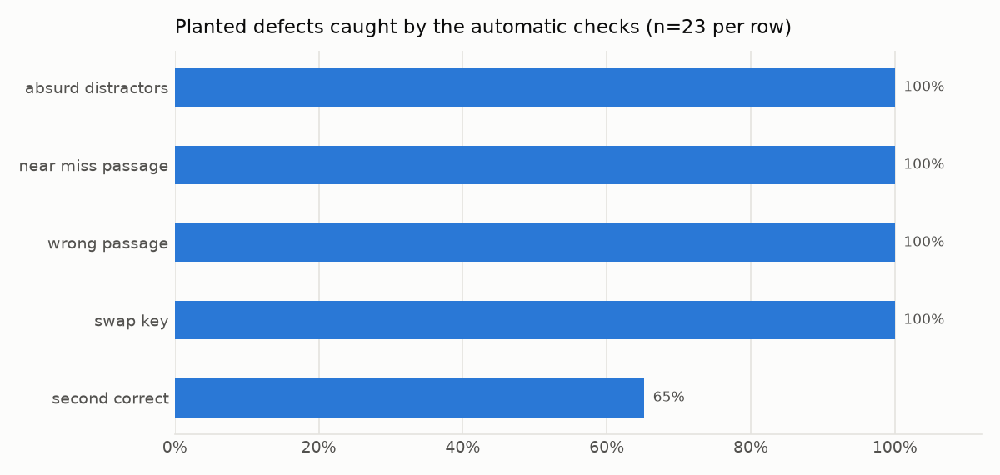
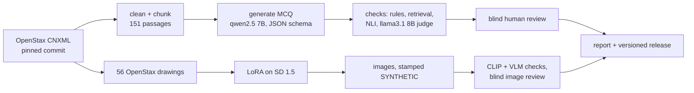
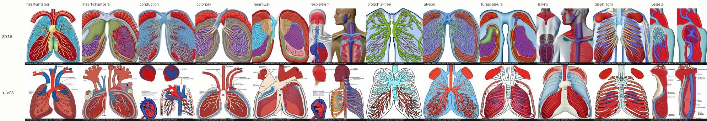
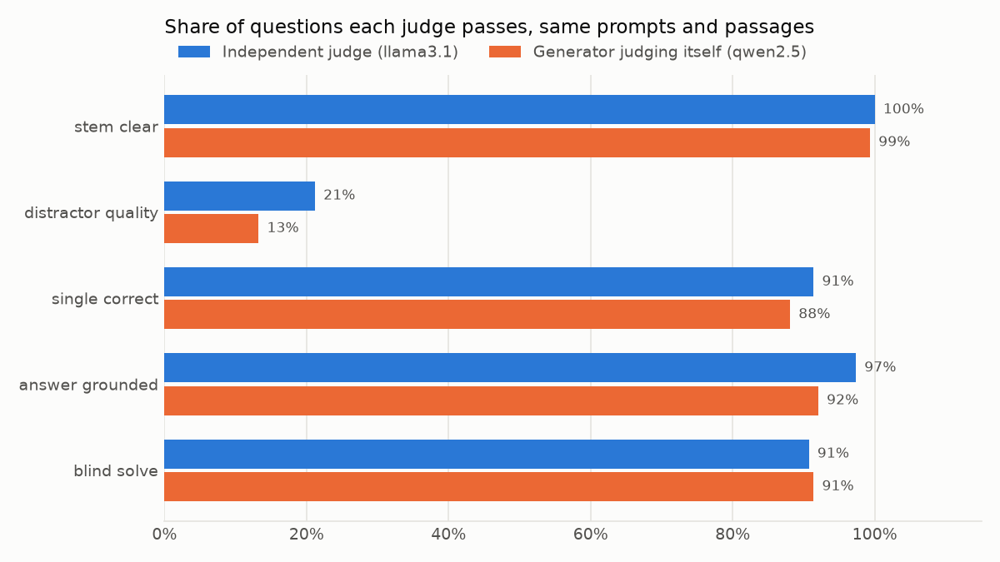

# MedQuiz Studio

[](https://github.com/Sarthak261-rgb/medquiz-studio/actions/workflows/ci.yml)

Grounded multiple-choice questions and teaching images for anatomy and physiology, generated from an open textbook on a laptop GPU, checked automatically, and reviewed by a person. Every question cites the exact paragraph it came from. Every image is stamped as synthetic.

The questions and images are not really the point. The point is measuring how often they are wrong, in which way, and how far the automatic checks can be trusted to catch it. Most of what I learned is in "What broke", below.

Everything ran on one RTX 4050 Laptop GPU (6 GB): a 7B generator, an 8B judge, an NLI model, Stable Diffusion 1.5 and a LoRA fine-tune.

A one-page overview of the project, with both pipelines and the main findings: **https://sarthak261-rgb.github.io/medquiz-studio/**

## Results at a glance

All numbers come from [`reports/results.md`](reports/results.md), which `medquiz report` rebuilds from the files in this repo. CI fails if a rerun changes it by a single byte.

| | |
|---|---|
| Questions generated | 151 (one per passage), 0 schema failures, 0 retries |
| Human review | in progress; the blind review screen and the report are ready for it |
| Auto-rejected by the configured gate | 84.8% (95% CI 78.2 to 89.6%) |
| Same gate without the judge's distractor-plausibility check | 14.6% |
| Same gate on the textbook's own 57 review questions | 89.5% rejected, which is the problem (see below) |
| Planted defects caught | wrong key 100%, wrong passage 100%, on-topic passage missing the fact 100%, absurd distractors 100%, paraphrased second answer 65% |
| Judge verdict flips when only the option order is reversed | 52% (12 of 23) |
| Judge picks the key from the four options alone, no stem | 53.6% (chance is 25%) |
| Citation anchors that resolve on openstax.org | 278 of 278 |
| Retrieval: book question finds its own section (R@1 / R@5) | 0.91 / 0.98 |
| Images generated | 96 (12 subjects x 4 seeds, base SD 1.5 and SD 1.5 + LoRA) |
| Images the VLM rejects when told what they should show | 0% |
| Images the same VLM rejects when not told (blind) | 43.8% base, 31.2% LoRA |
| GPU energy per generated question / per image | 0.354 Wh / 0.11 to 0.13 Wh, measured from the driver's energy counter |



## How it works



### Questions

1. Ingest. Chapters 19 (the heart) and 22 (the respiratory system) of *Anatomy and Physiology 2e* are read from OpenStax's CNXML source at a pinned commit. Figures, video boxes, references and exercises are dropped, and paragraphs are packed into 151 passages of 71 to 319 words that never cross a section. A test checks that all 32,506 words land in exactly one passage, and every passage keeps its paragraph ids, so a citation links to the exact paragraph.
2. Generate. One question per passage from `qwen2.5:7b-instruct`, forced into a JSON schema: stem, four options, key, explanation, a verbatim evidence quote, a one-sentence answer statement, and a Bloom level. Passages alternate between asking for recall and asking for reasoning. Options are shuffled with a seed afterwards, because the model put the key in A or B 69% of the time and in D only 12%.
3. Check. Twenty-one automatic checks (table below). A question auto-passes only if every *hard* check passes. *Soft* checks are recorded and scored against the human review, but never block.
4. Review. A Streamlit screen shows the question and the source passage with the evidence highlighted, and records accept or reject with reasons from a fixed taxonomy. The automatic verdicts stay hidden, so the labels are not anchored on the judge. Every decision is appended to `data/reviews/<reviewer>.jsonl`.
5. Report and release. `medquiz report` recomputes every number. `medquiz release` writes an immutable, hashed snapshot of the accepted questions.

### Images

1. Training set. 108 figures from chapters 19, 20 and 22. 12 are dropped because they are credited to third parties (photos and micrographs can carry other rights), 1 because the source file is truncated, and 39 because they are charts, tables, graphs or photos, which would teach the model boxes and fake text. That leaves 56 anatomical drawings, padded to 512 px rather than cropped so no structure is cut off.
2. LoRA. Rank 8 on the UNet attention layers of SD 1.5: 1.6 M trainable parameters, 1,200 steps, 31 minutes, 8 Wh and 2.05 GB of VRAM on the laptop. No horizontal flips, because a mirrored heart puts the left ventricle on the right.
3. Generate. 12 subjects x 4 seeds, the same prompts and seeds for both arms. Every image gets a visible "SYNTHETIC EDUCATIONAL IMAGE - NOT A REAL PATIENT" banner plus EXIF metadata saying the same, so it can never pass as a real patient image.
4. Check. A CLIP score, and qwen2.5-VL 3B asked twice: once told what the image should show, and once blind. In the blind run it names the structure it sees and transcribes every label, and two deterministic tests run on top of that: is the named structure the target organ, and are the label words real terms from the book?
5. Review. An image page in the same review app. Base and LoRA images are mixed in a fixed random order, and the screen never says which arm made an image, so the comparison is blind.



## The question checks

| Check | How | Blocks? | Catches |
|---|---|---|---|
| `options_distinct` | same words in the same order, ignoring articles and plurals | hard | two options saying the same thing |
| `no_all_none_of_above` | regex | hard | "all of the above", "A and B" |
| `stem_leak` | key text inside the stem | hard | the stem gives the answer away |
| `evidence_in_source` | every quoted sentence fuzzy-matched in the passage | hard | invented or misquoted evidence |
| `duplicate` | bge-small embeddings, cosine >= 0.92 | hard | near copies within the run |
| `judge_blind_solve` | llama3.1 answers from the passage without the key | hard | wrong key, or a second defensible answer |
| `judge_answer_grounded` | llama3.1 option-by-option audit | hard | key not supported by the passage |
| `judge_single_correct` | same audit | hard | a distractor the passage also supports |
| `judge_distractor_quality` | same audit, plausibility per distractor | hard | two or more throwaway distractors |
| `text_reference` | regex | soft | "according to the passage" (the student never sees it) |
| `negative_stem` | regex | soft | NOT / EXCEPT stems (NBME guidance) |
| `absolute_terms` | regex | soft | "always" / "never" distractors |
| `length_cue` | key length vs longest distractor | soft | the longest option is the key |
| `statement_consistent` | key text inside the answer statement | soft | the model's own key and statement disagree |
| `numeric_grounding` | every number in the key occurs in the passage | soft | invented or miscalculated figures |
| `key_terms_in_source` | lexical overlap | soft | key vocabulary absent from the passage |
| `citation_retrieval` | is the cited passage in the top 3 for stem + key? | soft | question drifted away from its source |
| `book_overlap` | similarity to the textbook's own review questions | soft | copying the book's questions |
| `nli_answer_entailed` | DeBERTa-v3 NLI over 1 and 2 sentence spans | soft | key not entailed by the passage |
| `nli_distractors_not_entailed` | NLI with each distractor swapped into the answer statement | soft | a distractor that is also entailed |
| `judge_stem_clear` | llama3.1 audit | soft | ambiguous stems |

Diagnostics that never block: `closed_book_solve` (can the judge answer with no passage? 75.5% yes), `options_only_solve` (can it pick the key from the options alone? 53.6%), and the judge's recall-or-reasoning label.

## Measuring the checks, not just the questions

An automatic check is only useful if you know how often it is wrong, so the checks are measured four ways.

- Against a person. Precision, recall and Cohen's kappa for the overall verdict and for every single check, with blind human labels as ground truth. Rates come with Wilson 95% intervals because the samples are small.
- Against planted defects. Questions that passed every check are broken on purpose in one known way, and re-checked. Because the defect is known, this needs nobody's opinion.
- Against the textbook's own questions. The 57 review MCQs the OpenStax authors wrote go through the same checks. The share the checks reject puts a floor on their false alarms.
- Against another judge. The same audit is run a second time with the generator itself as judge, to look for self-preference.



## What broke

These are the things that went wrong, kept because they are the useful part.

### The judge

- Its plausibility rating is not usable as a gate. llama3.1 8B labels 82% of distractors that the passage does not mention as "low plausibility", against 53% of the ones the passage contradicts. It is mostly saying "not in the passage", not "a student would never pick this". That one check accounts for almost all of the 84.8% auto-reject rate (14.6% without it), and it also rejects most of the textbook authors' own questions. I fixed the gate before any human review, so it is reported as it was rather than quietly tuned. The ablation table in the report shows what each check costs.
- Verdicts are not stable. Reversing the option order changed nothing about the question, and the judge's blind answer stayed the same every time, but the overall verdict flipped on 12 of 23 questions, every one of them through the plausibility labels.
- It answers from memory. Shown a passage from the other chapter, the judge still called the key "supported" 30% of the time. With an on-topic passage that lacks the fact, it did so 61% of the time. NLI was far better at this specific job: it caught 96% and 91%.
- It is weak on the textbook's own questions. Given the best-matching passage, the judge's blind solve got 75.4% of the authors' questions right. Part of that is the judge, and part is that some book questions need more than one passage.
- No self-preference, just disagreement. The generator judging its own questions was slightly harsher, not more lenient: 89.4% rejected against 84.8%. But the two judges agree on the overall verdict at kappa 0.09, which is barely above chance.

### The generator

- Prompt rules were not followed. The prompt says never to write "according to the passage". It appears in 25.8% of stems: 31% of reasoning questions and 21% of recall questions.
- "Recall" is often reasoning. Of 76 questions asked to be recall, the judge labelled 41 as reasoning.
- The options leak the answer. With no stem and no passage, the judge picked the key 53.6% of the time against 25% chance. Item-writing cues are real even when no single rule catches them.

### The tooling

- My first duplicate-option check was wrong. Fuzzy, order-blind matching flagged 13 of 151 questions, and all 13 were good contrasting options: "from the alveoli into the blood" against "from the blood into the alveoli", "increased" against "decreased". As a hard check, it would have rejected all of them. It now compares words in order, keeps operators like "x" and "-", and flags 0.
- Evidence matching needed calibrating. The model trims quotes with "..." and drops asides like "(see the figure)". Real quotes scored 80 or more, while the same quotes checked against an unrelated passage never went above 55, so the threshold is 75. It is set from this run, which the config says.
- NLI likes word overlap. "Hematology is the study of the heart" came out as entailed by "Cardiology is the study of the heart" (the heuristic McCoy et al. describe). A span can now only count as evidence for a distractor if it mentions that distractor's own terms.
- A sentence splitter bug. It did not split after a period inside a closing quote, and the merged sentence made the NLI model call an exact restatement "neutral".
- A JSON string that never ends. For a one-line paraphrase, the grammar kept qwen2.5 inside the JSON string, and it ran on into an invented next chat turn until the context filled up. Plain text with a newline stop fixed it.
- Part of each model was on the CPU. Ollama's memory estimate left about 20% of each 7-8B model's layers on the CPU of a 6 GB card. `num_gpu: 99` put everything on the GPU and made generation and judging 1.5 to 1.8 times faster.

### The images

- The VLM believes the prompt. Told "this image shows a frontal section of the heart with four chambers", qwen2.5-VL 3B agreed for 100% of images, including ones with no recognisable chambers at all, and called labels like "PROUAIY I PHH" readable. Blind, the same model rejected 43.8% of base images and 31.2% of LoRA images. An anchored judge is not a judge.
- Blind, it hallucinates instead. It "transcribed" knee and ovary terms from a blood-vessel image, and once looped on "Trachea" until the JSON broke. Retries with a different seed and a 25-label cap fixed the crash, not the hallucination.
- It read the safety banner as a label. Telling it to ignore the banner did not work, so the checker now gets a copy with the banner cropped off.
- The LoRA learned the style, labels included. LoRA images are visibly closer to the OpenStax drawings (see the contact sheet), and 72.9% of them carry label-like text against 41.7% for base, even with "text" in the negative prompt. The labels I looked at were not words, but the blind VLM "transcribed" many of them as real anatomy terms, so its 10.4% garbled-label rate is an undercount. In medicine that is the dangerous failure: a confident, wrong label.
- Loss says nothing about anatomy. Diffusion loss stayed flat and noisy, 0.061 to 0.073, while the images changed a lot. Only review shows whether they got better.

## What I'd do differently

- Put a doctor in the review loop and feed the rejection reasons back into the prompts (prompt v2, re-measure), instead of a single non-clinician reviewer.
- Drop distractor plausibility as a hard gate. Judge it by comparing the options against each other instead, and validate it against human labels before letting it block anything.
- Generate images without text and add the labels programmatically from a known structure list, so that no label is ever invented. Then use ControlNet with a reference outline to hold the anatomy fixed.
- Use a larger judge and VLM through an API for the checks, and report their cost per question against these local numbers.
- Move from textbook recall to NEET-PG and USMLE style clinical vignettes, and measure difficulty and discrimination with real students.

## Limits

- I am not a doctor. Nothing here has been reviewed by a clinician or a medical educator, and neither the questions nor the images should be used for teaching or assessment without that.
- One reviewer, so human-human agreement is unknown.
- Every judge here is a 3 to 8 billion parameter model running quantised on a laptop.
- Two chapters of text and three of figures. Tables and photos are excluded.
- Grounding is checked against one passage, so a correct question that needs two passages will look unsupported.
- The label-vocabulary check only knows words from these chapters, so a real but off-topic term (a knee bone on a vessel image) also counts as "not a textbook term".

## Run it

Needs Python 3.11, [uv](https://docs.astral.sh/uv/) and, for the pipeline, [Ollama](https://ollama.com) with an NVIDIA GPU.

```bash
uv sync --extra ml --extra images --extra dev
ollama pull qwen2.5:7b-instruct-q4_K_M
ollama pull llama3.1:8b-instruct-q4_K_M
ollama pull qwen2.5vl:3b
bash scripts/run_all.sh      # questions: ingest, generate, checks, control set, stress test, report
bash scripts/run_images.sh   # images: figures, base, LoRA training, LoRA images, checks
```

Every step resumes where it stopped. Then:

```bash
uv run medquiz review                       # blind review screen, questions and images
uv run medquiz report                       # rebuild reports/results.md
uv run medquiz release 0.1.0 --notes "first reviewed release"
uv run medquiz serve                        # FastAPI, /docs for the schema
```

The API and the review screen also run in Docker, without a GPU, over the committed runs and reviews: `docker compose up --build` (API on 8000, review screen on 8501).

## Reproducibility

- Source text and figures come from a pinned commit of `openstax/osbooks-anatomy-physiology`. `medquiz ingest --check-urls` confirms that every cited page loads and that all 278 cited paragraph ids exist on openstax.org.
- Each run records the Ollama model digests, a hash of every prompt and of the config, and the git commit of the code that generated and checked it.
- GPU energy is read from the NVIDIA driver's cumulative energy counter, per question and per stage. The per-question sums agree with the stage totals within 0.3%.
- CI runs lint and 48 tests, rebuilds the database from the committed JSONL, reruns `medquiz report`, and fails on any difference. It also builds the Docker image and smoke-tests the API.
- Releases are written once and never edited. `medquiz verify-release <version>` checks every file against the sha256 in its manifest.

## Layout

```
configs/default.yaml   every setting that changes results
prompts/               versioned prompts; the file name is the version
src/medquiz/
  ingest.py            CNXML -> blocks -> chunks, plus the book's own MCQs
  generate.py          passage -> cited MCQ
  checks/              rules, retrieval, NLI, LLM judge, the auto-verdict rule
  mutate.py            planted defects for the stress test
  control.py           textbook control set and retrieval eval
  images/              figures, SD 1.5 + LoRA, image checks, image review
  metrics.py, report.py, figures.py
  store.py, db.py      SQLite index over the JSONL files
  api.py               FastAPI
  release.py           versioned, hashed dataset releases
review_app/app.py      Streamlit review screen
runs/                  every generation and check result (append-only JSONL), images, the LoRA weights
data/reviews/          every human decision (append-only JSONL)
reports/               results.md, metrics.json, figures
```

## Licence

Code: MIT, see `LICENSE`. Data, images and LoRA weights (everything derived from the book): CC BY-NC-SA 4.0, see `DATA_LICENSE.md`. Source: Betts, J. G., et al., *Anatomy and Physiology 2e*, OpenStax, https://openstax.org/details/books/anatomy-and-physiology-2e. Access for free at openstax.org.
