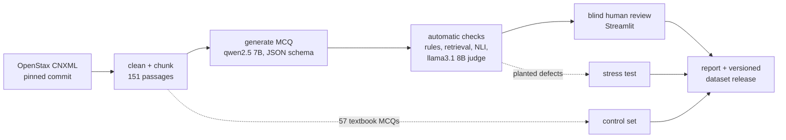

# MedQuiz Studio

Exam-style multiple-choice questions for anatomy and physiology, generated from an open textbook on a laptop GPU. Every question cites the paragraph it came from, goes through a stack of automatic checks, and then gets reviewed by a person.

The questions are not really the point. The point is measuring how often they are wrong, in which way, and how far the automatic checks can be trusted to catch it.

<!-- RESULTS -->

## How it works



1. **Ingest.** The heart chapter (19) and the respiratory chapter (22) of *Anatomy and Physiology 2e* are read straight from OpenStax's CNXML source on GitHub at a pinned commit. Figures, video boxes, references and exercises are dropped. Paragraphs are packed into 151 passages of 71 to 319 words that never cross a section boundary, and every passage keeps the paragraph ids it came from. A test checks that all 32,506 words land in exactly one passage.
2. **Generate.** One question per passage from `qwen2.5:7b-instruct` running in Ollama. The output is forced into a JSON schema (stem, four options, key, explanation, verbatim evidence quote, a one-sentence answer statement, Bloom level). Passages alternate between asking for a recall question and a reasoning question. The options are then shuffled with a seed, because the model put the key in position A or B most of the time.
3. **Check.** Twenty-one automatic checks, described below. A question auto-passes only if every *hard* check passes. *Soft* checks are recorded and scored against the human review, but never block.
4. **Review.** A Streamlit screen shows the question and the highlighted source passage, and records accept or reject with reasons from a fixed list. The checks stay hidden until a decision is submitted, so the human labels are not anchored on the judge. Every decision is appended to `data/reviews/<reviewer>.jsonl`.
5. **Report and release.** `medquiz report` recomputes every number in `reports/results.md` from the files in the repo. `medquiz release` writes an immutable, hashed snapshot of the accepted questions.

## The checks

| Check | How | Blocks? | Catches |
|---|---|---|---|
| `options_distinct` | fuzzy match between options | hard | two options saying the same thing |
| `no_all_none_of_above` | regex | hard | "all of the above", "A and B" |
| `stem_leak` | key text inside the stem | hard | the stem gives the answer away |
| `evidence_in_source` | every quoted sentence fuzzy-matched in the passage | hard | invented or misquoted evidence |
| `duplicate` | bge-small embeddings, cosine >= 0.92 | hard | near copies within the run |
| `judge_blind_solve` | llama3.1 answers from the passage without the key | hard | wrong key, or a second defensible answer |
| `judge_answer_grounded` | llama3.1 option-by-option audit | hard | key not supported by the passage |
| `judge_single_correct` | same audit | hard | a distractor the passage also supports |
| `judge_distractor_quality` | same audit, plausibility per distractor | hard | two or more throwaway distractors |
| `text_reference` | regex | soft | "according to the passage" (the student never sees it) |
| `negative_stem` | regex | soft | NOT / EXCEPT stems |
| `absolute_terms` | regex | soft | "always" / "never" distractors |
| `length_cue` | key length vs longest distractor | soft | the longest option is the key |
| `statement_consistent` | key text inside the answer statement | soft | the model's own key and statement disagree |
| `numeric_grounding` | every number in the key occurs in the passage | soft | invented or miscalculated figures |
| `key_terms_in_source` | lexical overlap | soft | key vocabulary absent from the passage |
| `citation_retrieval` | is the cited passage in the top 3 for stem + key? | soft | question drifted away from its source |
| `book_overlap` | similarity to the textbook's own review questions | soft | copying the book's questions |
| `nli_answer_entailed` | DeBERTa-v3 NLI over 1 and 2 sentence spans | soft | key not entailed by the passage |
| `nli_distractors_not_entailed` | NLI on the answer statement with each distractor swapped in | soft | a distractor that is also entailed |
| `judge_stem_clear` | llama3.1 audit | soft | ambiguous stems |

Diagnostics that never block: `closed_book_solve` (can the judge answer with no passage?), `options_only_solve` (can it pick the key from the four options alone, with no stem?), and the judge's recall-or-reasoning label.

## Measuring the checks, not just the questions

An automatic check is only useful if you know how often it is wrong. Four things are measured here.

- **Against a person.** Precision, recall and Cohen's kappa for the overall verdict and for every single check, using blind human labels as ground truth. Rates come with Wilson 95% intervals because the sample is small.
- **Against planted defects.** Questions that passed every check are broken on purpose in one known way: the key moved to a distractor, the question shown with a passage from the other chapter, an on-topic passage that lacks the fact, a paraphrase of the key slipped in as a distractor, off-topic distractors, or just the option order reversed. Because the defect is known, this measures the checks without needing anyone's opinion.
- **Against the textbook's own questions.** The 57 review MCQs the OpenStax authors wrote for these chapters go through the same checks. The share the checks reject is a floor on their false alarms. The same set measures retrieval: does a question find a passage from its own section?
- **Against itself.** The same blind solve and audit are run a second time with the generator as judge. If the generator passes its own questions more often than the independent judge does, that is self-preference.

## What broke along the way

These are the things that went wrong while building it, kept here because they are the useful part.

- **The prompt rules were not followed.** The prompt says never to write "according to the passage". The generator wrote it anyway in a sizeable share of stems, mostly in reasoning questions. That is why `text_reference` exists, and why it is soft: it is a fixable wording problem, not a wrong question.
- **Position bias.** Before the shuffle the key sat in position A or B about three times in four, and in D almost never.
- **NLI likes word overlap.** "Hematology is the study of the heart" came out as entailed by "Cardiology is the study of the heart", a textbook case of the lexical-overlap heuristic (McCoy et al., 2019). The fix was a guard: a passage span can only count as evidence for a distractor if it mentions that distractor's own terms.
- **A sentence splitter bug.** The splitter did not break after a period inside a closing quote (`"kardia." Cardiology is ...`). The merged sentence made the NLI model call an exact restatement "neutral". Caught by looking at a single surprising score.
- **Half the model was on the CPU.** Ollama's memory estimate left about 20% of the layers of both 7-8B models on the CPU of a 6 GB card. Forcing every layer onto the GPU (`num_gpu: 99`) made generation and judging 1.5 to 1.8 times faster.
- **The licence is not CC BY.** The project idea assumed OpenStax A&P is CC BY. It is CC BY-NC-SA 4.0, both in the source repo and on openstax.org, so the derived dataset carries the same licence.

## Limits

- I am not a doctor. The questions have not been reviewed by a clinician or a medical educator and should not be used for teaching or assessment without that.
- One reviewer. There is no second human rater, so human-human agreement is unknown.
- Both judges are 7 to 8 billion parameter models running quantised on a laptop. A larger judge would likely agree with the reviewer more often.
- Two chapters, text only. Figures and tables are dropped, so no question tests a diagram.
- Grounding is checked against one passage. A question that is correct but needs two passages will look unsupported.

## Run it

Needs Python 3.11, [uv](https://docs.astral.sh/uv/) and, for the pipeline, [Ollama](https://ollama.com) with an NVIDIA GPU. Tested on an RTX 4050 Laptop GPU (6 GB).

```bash
uv sync --extra ml --extra dev
ollama pull qwen2.5:7b-instruct-q4_K_M
ollama pull llama3.1:8b-instruct-q4_K_M
bash scripts/run_all.sh
```

`run_all.sh` runs ingest, generation, checks, the textbook control set, the stress test and the report. Every step resumes where it stopped.

To review and serve:

```bash
uv run medquiz review
uv run medquiz serve
uv run medquiz report
uv run medquiz release 0.1.0 --notes "first reviewed release"
```

The API and the review screen also run in Docker without a GPU, over the committed runs and reviews:

```bash
docker compose up --build
```

API on port 8000 (`/docs` for the schema), review screen on 8501.

## Reproducibility

- The source text is fetched from a pinned commit of `openstax/osbooks-anatomy-physiology`. `medquiz ingest --check-urls` confirms that every cited page loads and that all 278 cited paragraph ids exist on openstax.org, so each citation lands on its exact paragraph.
- Each run records the Ollama model digests, a hash of every prompt, a hash of the config, and the git commit of the code that generated and checked it.
- GPU energy comes from the driver's cumulative energy counter, read per question and per stage. It is measured, not estimated.
- CI runs the tests and lint, rebuilds the database from the committed JSONL, reruns `medquiz report`, and fails if `reports/results.md` or `reports/metrics.json` changes by a single byte. It also builds the Docker image and smoke-tests the API.
- Releases are written once and never edited. `medquiz verify-release <version>` checks every file against the sha256 in its manifest.

## Layout

```
configs/default.yaml   every setting that changes results
prompts/               versioned prompts; the file name is the version
src/medquiz/
  ingest.py            CNXML -> blocks -> chunks, plus the book's own MCQs
  generate.py          passage -> cited MCQ
  checks/              rules, retrieval, NLI, LLM judge, the auto-verdict rule
  mutate.py            planted defects for the stress test
  control.py           textbook control set and retrieval eval
  metrics.py           every reported number
  report.py, figures.py
  store.py, db.py      SQLite index over the JSONL files
  api.py               FastAPI
  release.py           versioned, hashed dataset releases
review_app/app.py      Streamlit review screen
runs/                  every generation and check result, append-only JSONL
data/reviews/          every human decision, append-only JSONL
reports/               results.md, metrics.json, figures
```

## Licence

Code: MIT, see `LICENSE`. Data (everything derived from the book): CC BY-NC-SA 4.0, see `DATA_LICENSE.md`. Source: Betts, J. G., et al., *Anatomy and Physiology 2e*, OpenStax, https://openstax.org/details/books/anatomy-and-physiology-2e. Access for free at openstax.org.
